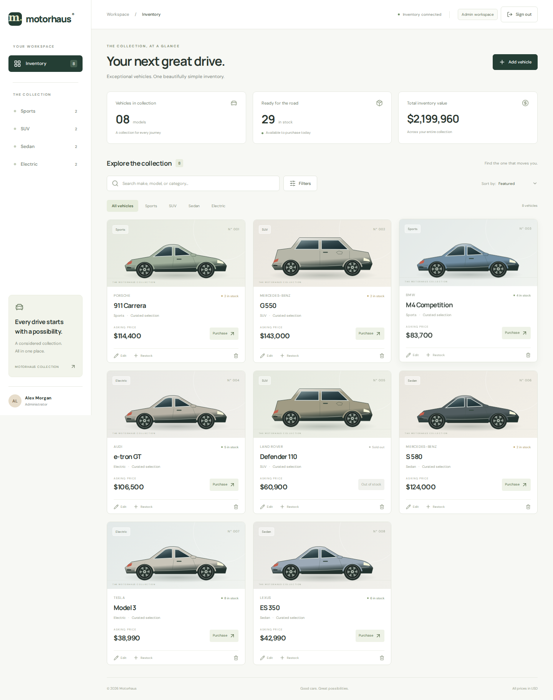
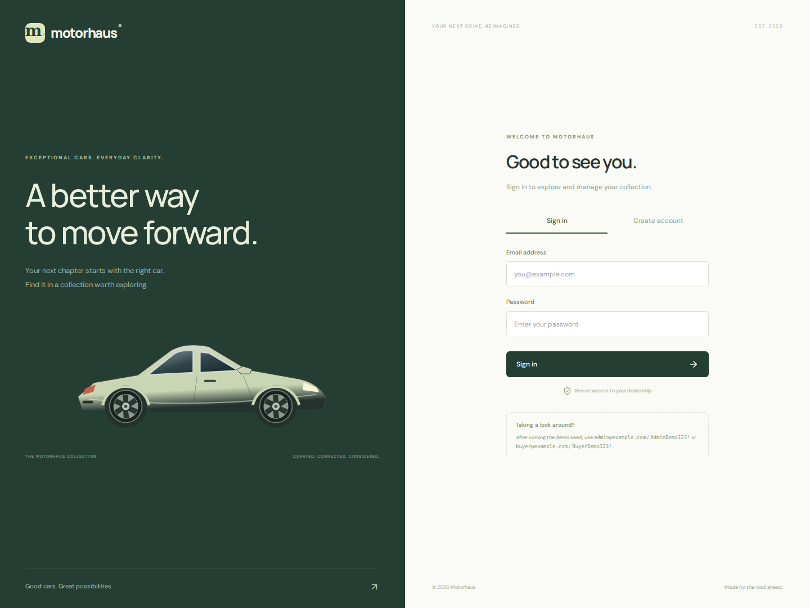
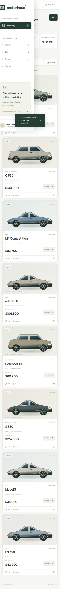

# Motorhaus — Car Dealership Inventory

A full-stack inventory application built for the TDD Car Dealership kata. Browse a curated collection, filter by make/model/category/price, purchase available vehicles, and manage stock through an administrator workspace.

**Stack:** Python 3.12 · FastAPI · SQLite on disk · JWT · React 19 · Vite · Tailwind CSS · pytest · Vitest · Playwright.

## Preview



<details><summary>Sign-in and mobile views</summary>





</details>

## Run locally

Requirements: **Python 3.12+**, **Node.js 22+**, npm, and Git. Run backend commands from the repository root.

```bash
git clone https://github.com/Ayush959/car-dealership-inventory.git
cd car-dealership-inventory
python3 -m venv .venv
source .venv/bin/activate
python -m pip install -r requirements.txt
python -m backend.seed
python -m uvicorn backend.app:create_app --factory --reload --port 8000
```

On Windows, use `python` instead of `python3`, and activate with `.venv\Scripts\Activate.ps1` in PowerShell.

In a second terminal:

```bash
cd frontend
npm ci
npm run dev
```

Open **http://localhost:5173**. Interactive API docs: **http://localhost:8000/docs**. Vite proxies `/api` to the backend. `npm run build` generates the production frontend in `frontend/dist`.

### Demo accounts

The seed command explicitly creates these **local demonstration accounts**, plus eight vehicles. It is safe to rerun: existing users and a populated collection are preserved.

| Role | Email | Password |
| --- | --- | --- |
| Administrator | `admin@example.com` | `AdminDemo123!` |
| Buyer | `buyer@example.com` | `BuyerDemo123!` |

Registration always creates a buyer. No request field can grant administrator privileges. For a different demo administrator, use `python -m backend.seed --admin-email you@example.com --admin-password 'YourStrongPassword'`. Do not use the demo accounts in a production deployment.

## Features and behavior

- Registration, login, a visible sign-out button in the sticky header on desktop and mobile, and an authenticated session that survives a page reload within the same tab. Signing out clears the saved session and resets the workspace filters.
- Responsive dashboard, original SVG vehicle illustrations, inventory valuation, stock counts, category tabs, free-text search, minimum/maximum price, in-stock filtering, and sorting.
- Purchase confirmation; sold-out vehicles cannot be purchased. A conditional SQL update prevents overselling during concurrent purchases.
- Administrator forms to add, edit, delete, and restock vehicles, with loading, error, success, and empty states.
- Disk-backed SQLite with constraints and write-ahead logging. Prices use integer cents to avoid floating-point storage errors.
- Salted PBKDF2-SHA256 password hashes with 600,000 iterations. HS256 tokens expire after eight hours; roles are checked against the database for each request.
- Input validation, parameterized SQL, bounded fields, restricted CORS, native accessible dialogs, labeled forms, keyboard focus indicators, and reduced-motion support.

Purchasing is an inventory operation; it does not charge a payment method. Vehicle illustrations are original representative artwork, not photographs of the listed models. Google Fonts is optional; local font fallbacks work without it.

## API

Send `Authorization: Bearer <access_token>` for protected routes. Register and login return `access_token`, `token_type`, and `user`.

| Method | Route | Access / purpose |
| --- | --- | --- |
| POST | `/api/auth/register` | Public: name, email, password |
| POST | `/api/auth/login` | Public: email, password |
| GET | `/api/auth/me` | Authenticated profile |
| GET | `/api/health` | Public database health check |
| GET | `/api/vehicles` | Authenticated: list vehicles, including sold-out records |
| GET | `/api/vehicles/search` | Authenticated: `make`, `model`, `category`, `q`, `min_price`, `max_price` |
| POST | `/api/vehicles` | Authenticated: create vehicle |
| PUT | `/api/vehicles/{id}` | Authenticated: replace vehicle details |
| DELETE | `/api/vehicles/{id}` | Administrator only |
| POST | `/api/vehicles/{id}/purchase` | Authenticated: purchase one unit; no body |
| POST | `/api/vehicles/{id}/restock` | Administrator: `{"quantity": 3}` |

Vehicle input example:

```json
{"make":"Porsche","model":"911 Carrera","category":"Sports","price":"114400.00","quantity":3}
```

Price is returned as a two-decimal string. Errors use FastAPI's `detail` property: `401` unauthenticated, `403` forbidden, `404` missing vehicle, `409` duplicate account/out of stock, and `422` invalid input.

**Permission interpretation:** the brief labels create/update as protected and explicitly labels only delete/restock as admin-only. The API follows that distinction; the management UI is visible only to admins as separately requested. Search is available through the API; the small dashboard collection is filtered locally for immediate feedback.

## Tests and TDD evidence

```bash
# From the root, with the virtual environment activated:
python -m pytest --cov --cov-report=term-missing

cd frontend
npm test
npm run build

# With the seeded API and frontend running:
npx playwright install --with-deps chromium
npm run test:e2e
```

The browser test expects the eight seeded vehicles, creates and deletes its own vehicle, and creates a uniquely named buyer. Run it against a local demo database. It also regenerates the screenshots.

See [TEST_REPORT.md](TEST_REPORT.md), [backend output](docs/backend-tests.txt), [frontend output](docs/frontend-tests.txt), and [browser output](docs/browser-tests.txt). The actual development history contains tests committed before implementations, recorded failing runs, passing implementations, and a startup regression discovered during integration. No commit history was backdated or reconstructed.

## Structure

```text
backend/
  app.py          HTTP routes, authentication dependencies, application factory
  database.py     SQLite connection lifecycle, schema, response mapping
  schemas.py      Validated request contracts
  security.py     Password hashing and token issuance
  seed.py         Explicit demo setup
  tests/          API, persistence, permissions, concurrency, regression tests
frontend/
  src/            React views, shared API client, original illustrations, styles
  e2e/            Real-browser workflow test
docs/             Test output and application screenshots
PROMPTS.md        Verbatim user-visible AI conversation transcript
```

## Configuration and scope

| Variable | Default |
| --- | --- |
| `DATABASE_PATH` | `inventory.db` in the project root |
| `JWT_SECRET` | Generated private `.jwt-secret` file for local development |
| `CORS_ORIGINS` | `http://localhost:5173,http://127.0.0.1:5173` |
| `VITE_API_URL` | Empty; uses the Vite `/api` proxy |

For deployment, set a stable `JWT_SECRET` of at least 32 characters, use HTTPS, configure the API URL/CORS origins, and mount persistent storage for SQLite. `.env` files are ignored but not automatically loaded; export variables through your shell or deployment platform. Database files, signing keys, dependencies, and build outputs are excluded from Git. A production deployment would additionally need login rate limiting, password reset, monitoring, migrations, and a backup policy. This kata does not implement payment processing, sales history, or multi-location stock.

## My AI Usage

**Tool used:** OpenAI Codex in the desktop application.

**How it was used:** I asked Codex to build this assignment under a short submission deadline. Codex read the supplied brief, chose the architecture, wrote API and frontend tests before the corresponding implementations, implemented the FastAPI/SQLite backend and React/Tailwind interface, created original vector illustrations, ran tests and builds, diagnosed a startup bug, wrote regression coverage, prepared screenshots and documentation, and created the Git history. This is substantial AI-generated work, not merely autocomplete. AI-assisted commits include a `Co-authored-by` trailer.

**Reflection:** AI made it possible to cover the full stack quickly, but the first successful API test run did not guarantee successful application startup: the browser setup exposed an untested development-key path. Recording that failure, adding a regression test, and fixing it demonstrates why execution and review matter more than plausible generated code. The implementation favors a small, explainable design over extra infrastructure. The submission owner should review the code and be prepared to explain the authentication, role checks, atomic stock update, money representation, and tradeoffs; no manual review that did not occur is claimed here.

The root [PROMPTS.md](PROMPTS.md) contains verbatim visible user and assistant messages exported from this conversation, rather than an AI-written summary. System instructions, hidden reasoning, credentials, and unrelated sessions are not included.
